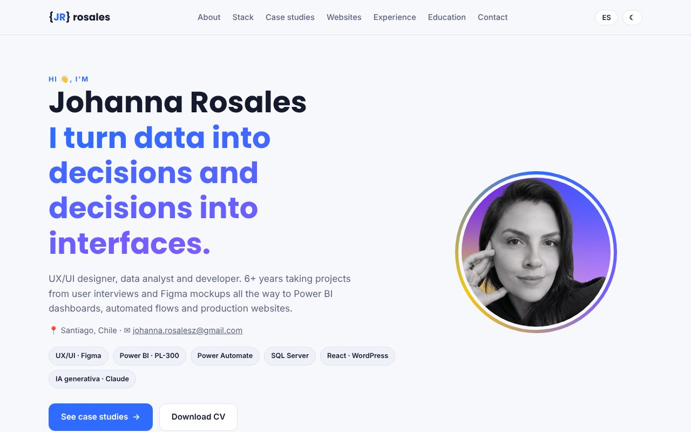

<div align="center">

# Johanna Rosales — Portfolio

**UX/UI Designer · Data & Power BI Analyst · Front-end Developer**

[](https://jrosales284.github.io)
[](#)
[](https://jrosales284.github.io/#contact)

<a href="https://jrosales284.github.io"></a>

</div>

## About

I turn data into decisions and decisions into interfaces. This site collects real case studies — from user interviews and Figma prototypes to Power BI dashboards, Power Automate flows and production websites.

## Case studies

| Case | Focus | Stack |
|---|---|---|
| [Sodexo Chile — People Analytics](https://jrosales284.github.io/casos/sodexo.html) | Staff turnover analytics | Power BI · DAX · Direct Lake · Power Automate · SQL Server |
| [Energuias Chile — BI & EXW freight quoter](https://jrosales284.github.io/casos/energuias.html) | Management scorecard, intranet, internal app | Power BI · SharePoint · React Native / Expo |
| [SIMEF Móvil — CIREN · CONAF · INFOR](https://jrosales284.github.io/casos/simef.html) | Native forest monitoring app | React · TypeScript · Vite · PWA |
| [BHP EMAS — Escondida & Spence](https://jrosales284.github.io/casos/bhp.html) | Environmental management platform | Figma · Design tokens · WCAG AA |
| [Chilexpress — Login redesign](https://jrosales284.github.io/casos/chilexpress.html) | UX research to high fidelity | Figma · React Native · Firebase Test Lab |

## Built with

Static HTML, CSS and vanilla JavaScript — no frameworks, no build step. Bilingual (ES/EN), light/dark mode, responsive, hosted on GitHub Pages.

```
├── index.html        Home
├── casos/            Case study pages
├── css/styles.css    Design tokens + styles
├── js/main.js        Language, theme, filters
├── img/              Screens and photos
└── cv/               CV in PDF
```

---

<sub>© 2026 Johanna Rosales · Santiago, Chile. Content and images are my own work; please don't reuse without permission.</sub>
